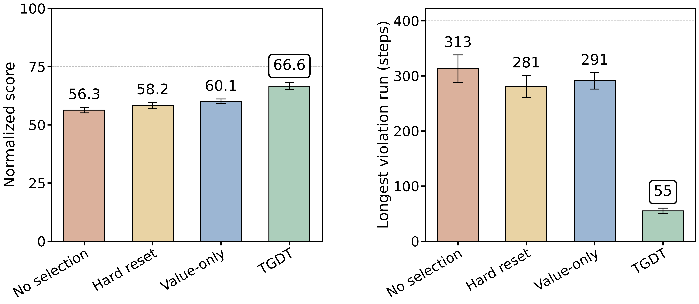
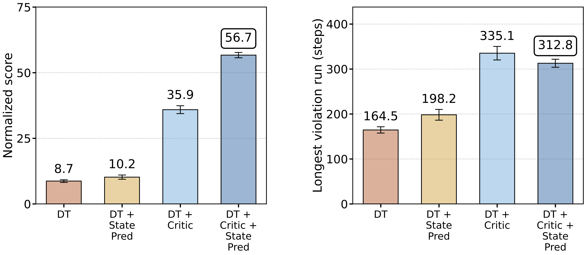

# Trust-Guided Decision Transformer (TGDT)

**Authors:** Chainesh Gautam¹, Raghuram Bharadwaj¹, Chandramouli Kamanchi², Pankaj Dayama², Sumantha Mukherjee², Kameshwaran Sampath²
¹ International Institute of Information Technology Bangalore  ² IBM Research Bangalore

---

## Overview

Decision Transformers (DT) treat offline reinforcement learning as sequence modelling: given a target return and the recent history of states and actions, the model predicts the next action. A policy trained this way can score well on average and still behave poorly at execution time. It can enter long stretches where its predictions no longer match what actually happens in the environment, and it keeps acting on them.

**TGDT** addresses this problem in two places:

1. **Training side:** a critic and a state-prediction head are added to the Decision Transformer.
2. **Execution side:** a *trust-guided* reliability filter decides at each step whether the model's proposed action can be relied on.

The experiments below, on **Maze2D `medium`** (D4RL), show that both parts matter. The training-side components raise the score but do not remove persistent high-error stretches. Execution-time trust filtering is what removes them.

> **TODO (authors):** add a one-paragraph description of how the trust score is computed, what the filter does when an action is rejected, and how this differs from the *Hard reset* and *Value-only* baselines.

---

## Metrics

Both figures report two quantities:

| Metric | Meaning | Better |
|---|---|---|
| **Normalized score** | D4RL normalized return (0 = random policy, 100 = expert reference) | Higher |
| **Longest violation run (steps)** | Length of the longest consecutive stretch of execution steps flagged as violations (persistent mismatch between the model and the environment) | Lower |

The second metric captures something the average score hides. Two policies with similar scores can differ a lot in how long they stay in an unreliable regime once they enter it.

---

## Result 1: Execution-time selection

*Figure 1. Comparison of execution-time selection strategies on Maze2D `medium`. Left: normalized D4RL score. Right: longest consecutive violation run.*

| Strategy | Normalized score ↑ | Longest violation run ↓ |
|---|---:|---:|
| No selection | 56.3 | 313 |
| Hard reset | 58.2 | 281 |
| Value-only | 60.1 | 291 |
| **TGDT** | **66.6** | **55** |

**What this shows**

- Applied at execution time, TGDT raises the normalized score from **56.3 to 66.6** (+10.3 points, about +18% relative to no selection).
- The larger effect is on persistence. The longest violation run falls from **313 to 55 steps**, a reduction of about **82%**.
- The two simpler alternatives barely shorten the violation run (281 and 291 steps) and raise the score only a little (+1.9 and +3.8 points). Resetting, or selecting on value alone, is not enough to get the model out of an unreliable regime.

---

## Result 2: Training-side ablation

*Figure 2. Ablation of training-side components on Maze2D `medium`. Left: normalized D4RL score. Right: longest consecutive violation run.*

| Model | Normalized score ↑ | Longest violation run ↓ |
|---|---:|---:|
| DT | 8.7 | 164.5 |
| DT + State Pred | 10.2 | 198.2 |
| DT + Critic | 35.9 | 335.1 |
| **DT + Critic + State Pred** | **56.7** | 312.8 |

**What this shows**

- **The critic is the main source of the score gain:** 8.7 → 35.9.
- **State prediction helps mostly in combination:** alone it adds little (8.7 → 10.2), but on top of the critic it raises the score from 35.9 to **56.7**.
- **Better training does not fix persistence.** The longest violation run stays high, or grows, as the score improves (164.5 → 312.8). A stronger policy travels further through the maze and can therefore spend longer in a mismatched regime. Training-side improvements alone do not detect or exit these stretches.

---

## Takeaway

Read together, the two experiments separate two roles:

- **The training-side components** (critic and state prediction) make the policy *capable*: they raise the score from 8.7 to 56.7.
- **Execution-time trust filtering** makes the policy *reliable*: it shortens the longest violation run from 313 to 55 steps while raising the score further, to 66.6.

The full model without any execution-time selection scores 56.7, and the *No selection* baseline in Figure 1 scores 56.3. This suggests that the Figure 1 baseline is the full trained model before trust filtering is applied.

> **TODO (authors):** confirm this. If it is correct, Figure 1 isolates the effect of the execution-time filter alone.

---

## Notes on the figures

- The bars show mean values and the error bars show variability across runs.
  > **TODO (authors):** state the number of seeds and whether the error bars are std or a confidence interval.
- The boxed values mark the proposed method in each panel.
- The figures are generated by `make_readable_charts.py`.
